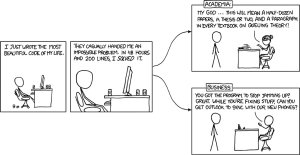

# Preface {.unnumbered}

This project was funded by the UCL [Changemakers programme](https://www.ucl.ac.uk/changemakers/). It was awarded by the [UCL Office for Open Science and Scholarship (OOSS) and the UK Reproducibility Network (UKRN)](https://www.ucl.ac.uk/library/open-science-research-support/open-science/about-office-open-science-scholarship/ucl-open-science). This student-led project established an innovative, open peer-review system for statistical science undergraduate coding assignments. It addresses a critical gap where students lacked opportunities for detailed, collaborative feedback on their code, a skill vital in both academia and industry.

The project team was Yinan Chen, Eric Chen, and Adelina Xie and with support from Dr Nathan Green.

{fig-align="center"}
